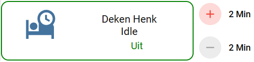
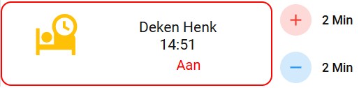

# 🔥 Je bed voorverwarmen met een warme deken.

Een Home Assistant project om een elektrische warmtedeken veilig en automatisch voor te verwarmen voordat je naar bed gaat.

De warmtedeken wordt via een slimme stekker ingeschakeld en schakelt zichzelf na een ingestelde tijd automatisch weer uit. Voor extra veiligheid kan de deken alleen worden ingeschakeld wanneer je thuis bent.

---
# De dashboardkaart toont twee situaties:




### Uitgeschakeld

- Groene rand

- Blauwe bed-icoon

- Status "Uit"

- Timer niet actief (Idle)

---



### Ingeschakeld

- Rode rand

- Gele bed-icoon

- Status "Aan"

- Resterende tijd zichtbaar

- Mogelijkheid om tijd toe te voegen of te verminderen

---

# Functionaliteiten

- Warmtedeken inschakelen via dashboard

- Alleen inschakelen wanneer je thuis bent

- Automatische uitschakeling na ingestelde tijd

- Handmatig uitschakelen via slimme stekker mogelijk

- Timer wordt automatisch geannuleerd bij uitschakelen

- Extra minuten toevoegen tijdens gebruik

- Tijd verminderen tijdens gebruik

- Dagelijkse veiligheidsuitschakeling om 23:59 uur

- Duidelijke dashboardkaart met resterende tijd

- Status van dashboard en slimme stekker blijven synchroon

---

# Benodigde Helpers

Maak onderstaande helpers aan via:

**Instellingen → Apparaten & Diensten → Helpers**

## Input Boolean

Wordt gebruikt als bediening van de warmtedeken.

```yaml
input_boolean.warme_deken_henk_enabled
```

---

## Timer

Wordt gebruikt voor de automatische uitschakeling.

```yaml
timer.warme_deken_henk_off
```

### Belangrijk

Stel in de automation waarin de timer start een standaardduur (duration) in.

- 00:15:00

of:

- 900 seconden

Deze tijd wordt gebruikt als basis voor de automatiseringen.

---

# Benodigde Hardware

## Slimme stekker

De warmtedeken wordt aangesloten op een slimme stekker.

Voorbeeld:

```yaml
switch.deken_henk_stopcontact_1
```

Natuurlijk vervang je deze entity door de entitynaam van jouw eigen slimme stekker in Home Assistant.

---

## Device Tracker

Voor de aanwezigheidscontrole wordt een device tracker gebruikt.

Voorbeeld:

```yaml
device_tracker.sm_s721b
```

Ook deze vervang je door jouw eigen telefoon of apparaat.

Voorbeelden:

device_tracker.pixel_8
device_tracker.iphone_15
device_tracker.galaxy_s25

---

# Werking

## Stap 1

Je schakelt de bediening in via het dashboard.

```yaml
input_boolean.warme_deken_henk_enabled
```

---

## Stap 2

Home Assistant controleert of je thuis bent.

```yaml
zone.home
```

Wanneer je niet thuis bent gebeurt er niets.

---

## Stap 3

De slimme stekker wordt ingeschakeld.

```yaml
switch.turn_on
```

---

## Stap 4

Bij het inschakelen van de stekker wordt automatisch de timer gestart.

Standaard:

- 900 seconden

oftewel:

- 15 minuten

---

## Stap 5

Wanneer de timer afloopt wordt de slimme stekker automatisch uitgeschakeld.
OF wanneer het 23:59 uur is. 

---

## Stap 6

De Input Boolean wordt automatisch teruggezet naar Uit.

Hierdoor blijft de dashboardweergave altijd overeenkomen met de werkelijke situatie.

---

# Veiligheid

Elektrische warmtedekens produceren warmte.

Om risico's te beperken zijn meerdere beveiligingen ingebouwd.

---

## Thuiscontrole

De warmtedeken kan uitsluitend worden gestart wanneer de opgegeven telefoon of tracker aanwezig is in:

```yaml
zone.home
```

---

## Automatische uitschakeling

Na afloop van de timer wordt de deken automatisch uitgeschakeld.

Standaard:

- 15 minuten

---

## Nachtelijke beveiliging

Ongeacht de timerstatus wordt de warmtedeken iedere nacht uitgeschakeld om:

- 23:59

Hierdoor kan de deken nooit onbeperkt blijven ingeschakeld.

---

## Statussynchronisatie

Wanneer:

- de slimme stekker handmatig wordt uitgezet
- de slimme stekker via de app wordt uitgezet
- de slimme stekker door een andere automation wordt uitgezet

dan gebeurt automatisch:

```yaml
input_boolean.turn_off
```

Hierdoor raken dashboard en slimme stekker nooit uit synchronisatie.

---

# Automations

Het project bevat vier automations.

---

## 1. Warme deken Henk

Schakelt de slimme stekker in wanneer de bediening wordt geactiveerd.
maar.....
Controleert eerst of je thuis bent.

---

## 2. Warme deken Henk start timer

Wordt gestart zodra de slimme stekker wordt ingeschakeld.
En controleerd voor de zekerheid nogmaals of je thuis bent.....
Start automatisch de timer.

---

## 3. Warme deken Henk cancel timer

Wordt gestart wanneer de slimme stekker wordt uitgeschakeld.

Acties:

- Timer stoppen
- Input Boolean resetten

---

## 4. Warme deken Henk uit

Schakelt de slimme stekker uit wanneer:

- de timer afloopt
- de bediening wordt uitgezet
- het 23:59 uur is

---

# Script

## Extra tijd toevoegen

Met het meegeleverde script kan extra tijd worden toegevoegd aan een actieve timer.

Het script herberekent automatisch de resterende tijd.

Voorbeeld:

```text
Resterende tijd : 12:30
Extra tijd      : 10:00
Nieuwe tijd     : 22:30
```

Hierdoor blijft reeds opgebouwde tijd altijd behouden.

---

## Voorbeelden

| Actie | Resultaat |
|----------------------------|-------------------|
| 1  x op +2 minuten drukken |  2 minuten extra  |
| 5  x op +2 minuten drukken | 10 minuten extra  |
| 10 x op +2 minuten drukken | 20 minuten extra  |

---

# Dashboardkaart

De dashboardkaart toont:

- Status Aan / Uit
- Resterende tijd
- Knop voor inschakelen
- Knop voor uitschakelen
- Tijd toevoegen
- Tijd verminderen

---

## Kleuren

| Kleur | Betekenis |
|-------------|----------------------------|
| Groen       | Warmtedeken uitgeschakeld  |
| Rood        | Warmtedeken ingeschakeld   |
| Grijs       | Bediening niet beschikbaar |
| Geel icoon  | Actieve warmtedeken        |
| Blauw icoon | Inactieve warmtedeken      |

---

## Niet thuis

Wanneer de gekozen device tracker niet thuis is:

- wordt de kaart grijs weergegeven
- kan de deken niet worden ingeschakeld
- kunnen geen minuten worden toegevoegd

---

# Vereiste HACS Componenten

Voor de dashboardkaart zijn onderstaande HACS-componenten nodig.

- Button Card
- Mushroom Cards
- Card Mod
---

# Aanpassen naar je eigen situatie

Vervang onderstaande entities door je eigen entities.

## Device Tracker

Van:

```yaml
device_tracker.sm_s721b
```

Naar bijvoorbeeld:

```yaml
device_tracker.mijn_telefoon
```

---

## Slimme stekker

Van:

```yaml
switch.deken_henk_stopcontact_1
```

Naar bijvoorbeeld:

```yaml
switch.slaapkamer_warmtedeken
```

---

## Timer

Van:

```yaml
timer.warme_deken_henk_off
```

Naar bijvoorbeeld:

```yaml
timer.warme_deken_timer
```

---

## Input Boolean

Van:

```yaml
input_boolean.warme_deken_henk_enabled
```

Naar bijvoorbeeld:

```yaml
input_boolean.warme_deken_enabled
```

---

# Installatie

1. Maak de Input Boolean helper aan.
2. Maak de Timer helper aan.
3. Stel een standaard timerduur in van 15 minuten.
4. Vervang alle entities door jouw eigen entities.
5. Importeer het script.
6. Importeer de automations.
7. Installeer de benodigde HACS-componenten.
8. Voeg de dashboardkaart toe.
9. Controleer alle entitynamen nogmaals.
10. Test de werking handmatig voordat je de automatisering dagelijks gebruikt.

---

# Disclaimer

⚠️ Een elektrische warmtedeken produceert warmte en dient altijd gebruikt te worden volgens de instructies van de fabrikant.

Deze automatisering bevat meerdere beveiligingen, waaronder een maximale looptijd, aanwezigheidscontrole en een dagelijkse veiligheidsuitschakeling.

De automatisering vervangt nooit de ingebouwde veiligheidsvoorzieningen van de warmtedeken zelf.

## Licentie en gebruiksvoorwaarden

Deze automatisering mag vrij worden gebruikt en aangepast voor eigen gebruik.

Bij het publiceren, verspreiden of delen van deze deze automatisering, of van geheel of gedeeltelijk daarop gebaseerde aangepaste versies, is bronvermelding verplicht. Daarbij moet de oorspronkelijke auteur worden vermeld en moet, waar redelijkerwijs mogelijk, een verwijzing naar de oorspronkelijke repository worden opgenomen.

Het is niet toegestaan deze automatisering of afgeleide versies als volledig eigen oorspronkelijk werk te presenteren zonder de oorspronkelijke auteur te erkennen.

Deze automatisering wordt aangeboden zonder enige garantie. Gebruik en aanpassing geschieden op eigen risico. Voor zover wettelijk toegestaan aanvaardt de auteur geen aansprakelijkheid voor schade die voortvloeit uit het gebruik of de aanpassing ervan.
